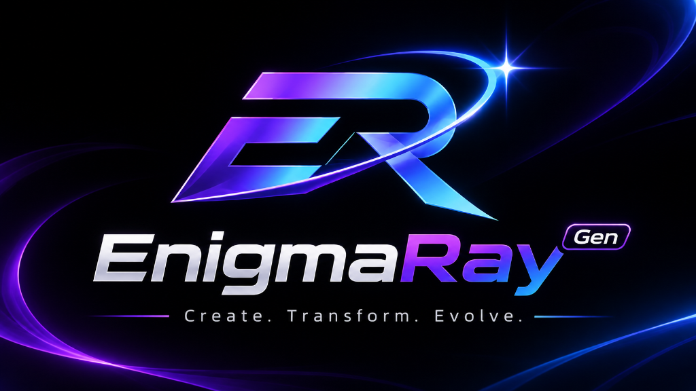

# ⚡ Enigma Ray — Next-Gen AI Image, Video & Cinema Studio

<div align="center">
  

  <br/><br/>

  [](LICENSE)
  [](https://nextjs.org)
  [](https://react.dev)
  [](https://vitejs.dev)
  [](https://tailwindcss.com)
  [](#-supported-models--studios)
  [](#-desktop-application-builds)

  <h3><b>Create. Transform. Evolve.</b></h3>
  <p><i>The unified creative workstation for generative AI images, cinematic video production, audio-driven lip sync, and node-based visual workflow automation.</i></p>
</div>

---

## 🌌 Overview

**Enigma Ray** is a high-performance, self-hosted generative AI creative suite built for artists, filmmakers, game designers, and digital creators. Designed from the ground up to eliminate platform restrictions, subscription paywalls, and fragmented tools, Enigma Ray consolidates **600+ state-of-the-art AI models** across **15+ specialized creative studios** into a unified dark glassmorphism interface.

Whether running via cloud model APIs or fully offline on local consumer GPUs using built-in C++ inference engines, Enigma Ray delivers uncompromised creative control.

---

## ✨ Creative Studios Suite

### 1. 🖼️ Image Studio (Dual Mode)
Intelligent dual-mode canvas that automatically reconfigures its model catalog and parameters based on your inputs:
* **Text-to-Image (50+ models):** Flux.1 Dev/Schnell, Nano Banana 2, Seedream 5.0, Ideogram v3, Midjourney v7, SDXL Base, GPT-4o Image.
* **Image-to-Image (55+ models):** Nano Banana 2 Edit, Flux Kontext Dev, Seededit v3, Upscaler, Background Remover, and Style Transfer.
* **Multi-Image Conditioning:** Upload and condition generations with up to **14 reference images simultaneously** with explicit selection order badges.
* **Dynamic Sizing:** Automatic adaptation of aspect ratios (16:9, 9:16, 1:1, 4:3, 21:9) and resolutions (1K, 2K, 4K) per model capability.

### 2. 🎬 Video Studio (Dual Mode)
Turn text prompts or still frames into fluid, cinematic video sequences:
* **Text-to-Video (40+ models):** Kling v3, Sora, Veo 3, Wan 2.2 / 2.6, Seedance 2.0, Hailuo 02 / 2.3 Pro, Runway Gen-3.
* **Image-to-Video (60+ models):** Animate any reference image with realistic motion dynamics (Veo3 I2V, Kling I2V, Seedance 2.0 I2V, Runway I2V).
* **Video Extension (Seedance 2.0 Extend):** Seamlessly continue existing video clips while preserving temporal consistency, character styling, motion vectors, and audio.

### 3. 🎥 Cinema Studio (Virtual Optical Simulation)
A dedicated interface for directors and visual artists to dial in photorealistic virtual camera rigs:
* **Virtual Camera Bodies:** Modular 8K Digital, Full-Frame Cine Digital, Grand Format 70mm Film, Studio Digital S35, Classic 16mm Film.
* **Cine Lenses:** Compact Anamorphic, Vintage Prime, 70s Cinema Prime, Clinical Sharp Prime, Creative Tilt, Halation Diffusion, Swirl Bokeh Portrait.
* **Focal Lengths & Apertures:** 8mm (Ultra-Wide), 14mm, 24mm, 35mm (Human Eye), 50mm (Standard Portrait), 85mm (Tight Cine); aperture control from `f/1.4` (shallow depth-of-field) to `f/11` (deep focus).

### 4. 🎙️ Lip Sync Studio
Generate audio-synchronized talking character videos using 9 specialized neural speech-to-motion models:
* **Portrait Mode (Image + Audio → Video):** Infinite Talk, Wan 2.2 Speech-to-Video, LTX 2.3 Lipsync, LTX 2 19B.
* **Video Mode (Video + Audio → Lipsync Video):** Sync Lipsync, LatentSync, Creatify Lipsync, Veed Lipsync, Infinite Talk V2V.

### 5. 🔀 Workflow Studio (Visual Node Pipeline)
Build and execute complex multi-step generative AI pipelines without writing code:
* **Node-based Visual Graph:** Connect image models, video models, audio synthesizers, and prompt transformers in a drag-and-drop node workspace.
* **Interactive Playground:** Test and inspect parameters and intermediate outputs at each node in real-time.
* **Community & Custom Templates:** Save, export, and load pre-built workflows for rapid production.

### 6. 🤖 Agent Studio & Design Agent
* **Conversational Creative Agent:** Natural language AI assistant that plans, refines, and executes media generation tasks turn-by-turn.
* **Autonomous Design Canvas:** Layer-based canvas for iterative visual work, composition editing, and multi-asset layout structuring.

### 7. ⚡ Additional Specialized Studios
* **Audio Studio:** Text-to-audio, ambient soundscape design, and musical composition.
* **AI Clipping:** Automated highlight detection and viral reel extraction from long-form video footage.
* **Vibe Motion & Motion Control:** Trajectory and motion-guided stylization for experimental animation.
* **Body Swap (Recast Studio):** Character and subject replacement across images and video frames.
* **Marketing & AI Influencer Studio:** Multi-variant campaign generator and persistent AI persona management.

---

## ⚡ Local Hardware Inference (Offline GPU / CPU)

For zero-cost, private generation, Enigma Ray integrates **two independent local engines** directly into the desktop and self-hosted environments:

| Engine | Architecture | Target Hardware | Supported Models |
| :--- | :--- | :--- | :--- |
| **sd.cpp** | C++ Diffusion Transformer ([stable-diffusion.cpp](https://github.com/leejet/stable-diffusion.cpp)) | Apple Silicon (Metal GPU), Windows/Linux (CUDA / Vulkan) | SD 1.5, SDXL Base 1.0, Dreamshaper 8, Realistic Vision, Z-Image Turbo / Base |
| **Wan2GP** | Headless PyTorch CLI & MCP Server ([Wan2GP](https://github.com/deepbeepmeep/Wan2GP)) | NVIDIA / AMD GPUs (Local or remote LAN/Cloud machine) | Wan 2.1 (1.3B / 14B), Wan 2.2, Hunyuan Video 1.5, LTX-2 Distilled, Flux.1 Dev, Qwen-Image 20B |

---

## 🚀 Quick Start

### Prerequisites
* **Node.js** (v18.0.0 or higher)
* **Git**

### Installation

```bash
# Clone the repository
git clone https://github.com/abdulrehmanazizofficial/Enigma-Ray.git
cd Enigma-Ray

# Install dependencies and build shared packages
npm install
npm run build:packages
```

### Running Locally

Enigma Ray provides two frontend options out of the box:

```bash
# 1. Full Next.js Web Application (Recommended)
npm run dev
# Opens at http://localhost:3000 (auto-redirects to /studio)

# 2. Lightweight Vite Client
npm run vite:dev
# Opens at http://localhost:5173

# 3. Native Desktop App (Electron)
npm run electron:dev
```

---

## 🏗️ Architecture & Monorepo Layout

Enigma Ray uses an npm workspaces monorepo architecture linking specialized frontend components and modular studio engines:

```
Enigma-Ray/
├── app/                                 # Next.js 15 App Router
│   ├── layout.js                        # Root Layout with Enigma Ray meta & font configuration
│   ├── page.js                          # Root entry point
│   ├── studio/[[...slug]]/page.js       # Main unified studio shell
│   └── api/                             # Server API routes & proxy bridges
├── components/                          # Core UI components
│   ├── StandaloneShell.js               # Responsive navigation, tab controller, status headers
│   └── ApiKeyModal.js                   # Authentication & BYOK modal
├── packages/                            # Monorepo workspace packages
│   ├── studio/                          # Shared studio React component suite (15+ studios, 400+ model definitions)
│   ├── Vibe-Workflow/                   # Visual node-based workflow builder engine
│   ├── Open-Poe-AI/                     # Conversational creative agent package
│   └── Open-AI-Design-Agent/            # Interactive canvas design agent package
├── public/                              # Static brand assets (banner.png, icon.png, favicon.png)
├── src/                                 # Vite client frontend & Vanilla JS studio shell
├── messages/                            # Localization message bundles (English & Chinese)
└── electron/                            # Native desktop runtime & local inference manager
```

---

## 📦 Desktop Application Builds

Packaged standalone desktop executables can be built using Electron Builder:

```bash
# Windows (NSIS Installer — x64)
npm run electron:build:win

# macOS (DMG — Apple Silicon & Intel)
npm run electron:build

# Linux (AppImage & DEB — x64)
npm run electron:build:linux

# All platforms in one pass
npm run electron:build:all
```

Outputs are written to the `release/` directory.

---

## 🔒 Privacy & BYOK Model

* **Zero Cloud Lock-in:** API keys are stored solely in your local browser `localStorage` and never proxied to unauthorized third parties.
* **Persistent Local Asset History:** Uploaded reference images and generated media are cataloged in browser storage for instant reuse across sessions.
* **Offline Ready:** Switch any studio to the **⚡ Local** engine to run entirely offline with zero internet connectivity required.

---

## 📄 License

Distributed under the **MIT License**. See [`LICENSE`](LICENSE) for details.

---

<div align="center">
  <b>Enigma Ray</b> — Created & Maintained by <a href="https://github.com/abdulrehmanazizofficial">abdulrehmanazizofficial</a>
  <br/>
  <sub>Create. Transform. Evolve.</sub>
</div>
